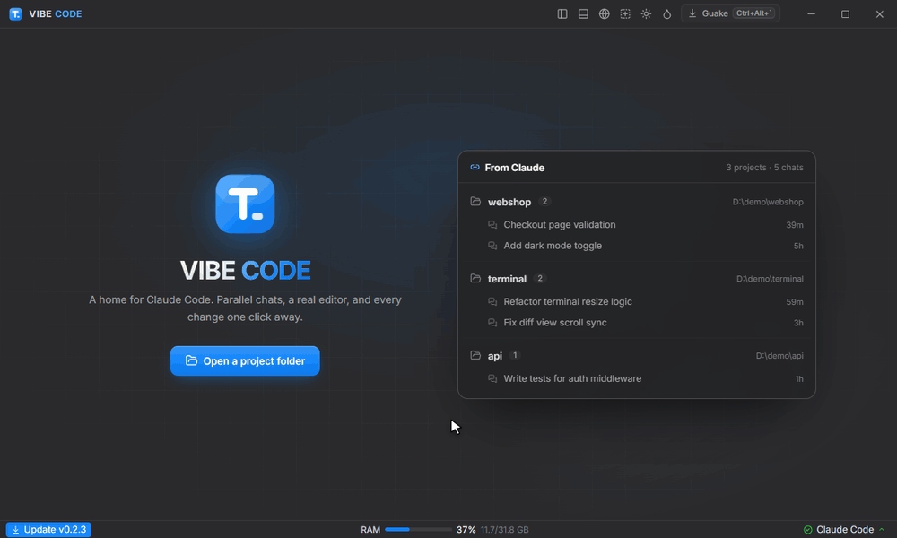

# VIBE CODE

Desktop workspace for **Claude Code**: several parallel chats, a Monaco editor (the VS Code editor core), a live Git *Changes* panel with diff view, an integrated terminal, and a screen-capture tool that drops marked-up screenshots straight into the chat.

## Download

**[⬇ Download VIBE CODE for Windows (x64)](https://github.com/nguyentrantin98/vibecode/releases/latest/download/vibe-code_x64-setup.exe)**

All versions and release notes: [Releases](https://github.com/nguyentrantin98/vibecode/releases).

Run the installer (no admin rights needed, it installs for the current user). VIBE CODE also needs:

- **Claude Code CLI** on PATH: `npm install -g @anthropic-ai/claude-code`, then sign in once with `claude`
- **Git** on PATH
- Windows 10/11 (WebView2 is installed automatically if missing)

**Updates:** when a new version is published, an **Update vX.Y.Z** button appears at the left of the status bar. Click it: the app downloads the installer, updates itself and restarts.



## Features

- **Parallel chats**: run several Claude Code sessions side by side, per project. Other agents (Codex, Gemini…) work too.
- **Claude history**: the Chats sidebar lists every project and conversation from `~/.claude/projects` (shared with the Claude desktop app, the CLI and the IDE extensions) and updates live. Clicking a conversation resumes it in its own folder.
- **Editor + Git**: Monaco editor, go to file / symbol, a live *Changes* panel with diffs, commit history and a branch switcher.
- **Terminal**: integrated terminals (ConPTY, WebGL rendering).
- **Web / Database / Zalo tabs**: a built-in browser, SQL Server explorer and Zalo inbox that Claude can also use through its tools.
- **Screen capture**: **Ctrl+Alt+Z** grabs the screen as it is, VIBE CODE included (so you can capture the app itself); the dashed-square button in the title bar hides VIBE CODE first and grabs what is behind it. Drag to pick a region (click for the whole screen), with a magnifier, size label and colour picker. Then mark it up with rectangle, ellipse, arrow, pen, highlighter, text, mosaic (hide sensitive info) and numbered steps. **Send** copies it to the clipboard and attaches it to the active chat. You can also just copy it or save it as a PNG.
- **Drop-down (Guake) mode**: a global hotkey slides VIBE CODE over any app.
- **Attachments**: paste or drop images and files into a chat. They wait in a tray until you send.

## Shortcuts

All commands with their keys are listed in the command palette (**Ctrl+Shift+P** or **F1**).
Bindings follow VS Code / Windows Terminal. Keys that mean something in a terminal (Ctrl+B, Ctrl+W,
Ctrl+J, Ctrl+O, Ctrl+L, Ctrl+T…, used by readline and Claude Code) go to the terminal while it has
the cursor.

| Keys | Action |
|---|---|
| Alt+` (global) | Show / hide VIBE CODE (drop-down slides over any app) |
| Ctrl+Alt+Z (global) | Capture the screen |
| Ctrl+Shift+P / F1 | Command palette |
| Ctrl+P | Go to file (`@` symbol, `:` line, `>` commands) |
| Ctrl+Shift+O / Ctrl+G | Go to symbol / line in the open file |
| Ctrl+Shift+N | New chat |
| Alt+1…9 · Ctrl+Alt+← / → | Switch chat · previous / next chat |
| Ctrl+Shift+L | Put the cursor in the open chat |
| Ctrl+1 / 2 / 3 / 4 | Source code / Web / Database / Zalo tab |
| Ctrl+Shift+E / G / C | Explorer / Changes / Chats |
| Ctrl+` · Ctrl+J · Ctrl+Shift+` | Toggle terminal · toggle panel · new terminal |
| Ctrl+B | Toggle sidebar |
| Ctrl+S · Ctrl+W (Ctrl+F4) · Ctrl+Shift+T | Save · close editor tab · reopen closed tab |
| Ctrl+Tab / Ctrl+Shift+Tab (Ctrl+PgDn / PgUp) | Next / previous editor tab |
| Ctrl+O | Open folder |
| Ctrl+C (with selection) / Ctrl+Shift+C · Ctrl+V | Copy / paste in a terminal |
| Ctrl+= / Ctrl+− / Ctrl+0 | Terminal font size |
| Shift+Enter (in chat) | Newline in Claude prompt |

F5 / Ctrl+R never reload the app window (that would blank every chat).

**In the capture editor:** V move/resize · R rectangle · E ellipse · A arrow · P pen · H highlighter · T text · B mosaic · N numbered step · Shift (while drawing) square / circle · arrow keys nudge the region · Ctrl+Z undo · Ctrl+C copy · Ctrl+S save · Enter or double-click send to chat · Esc / right-click cancel.

## Drop-down (Guake) mode

Click **Guake** in the title bar (or use the tray icon menu). VIBE CODE then lives at the top edge of the screen under the mouse: the global hotkey slides it down over whatever app you're in and back up again. The tray menu sets height, opacity and "hide when focus is lost". Dragging the bottom edge changes the height. The hotkey is `hotkey` in `%APPDATA%\TINJS Studio\settings.json` (F12 can't be used: Windows reserves it for debuggers).

## Development

Stack: Tauri 2 (Rust backend, system WebView2 / WKWebView) · React · TypeScript · Vite · Monaco · xterm.js (WebGL) · portable-pty (ConPTY)

```bash
npm install
npm run dev          # tauri dev: Vite with hot reload + the Rust backend
npm run build        # release build + installer in src-tauri/target/release/bundle/
npm run release      # bump the patch version, build, commit, push and publish a GitHub release
npm run release 0.3.0  # same, with an explicit version
```

Building needs Node 24+, Rust (stable, MSVC toolchain on Windows) and, on Windows, the
Visual Studio C++ Build Tools. The app itself has no Node runtime.

`npm run release` uploads the installer as `vibe-code_x64-setup.exe` on a `vX.Y.Z` release. The
download link above and the in-app Update button both use the latest release. It needs a GitHub token:
`GITHUB_TOKEN`, or the credential git already has for github.com.

`STUDIO_USER_DATA=<folder>` runs with a separate profile (settings, logins, Zalo session).

## Layout

- `src-tauri/src`: Rust backend. Terminals (`pty.rs`), files and the file watcher, git, Claude's session
  store, SQL Server (`mssql.rs`), Zalo (`zalo/`), the built-in browser (`browser.rs`, native
  WebView2 tabs that sleep when hidden), the MCP server Claude's tools talk to (`mcp.rs`), window /
  tray / drop-down mode (`windowing.rs`), screen capture (`capture.rs` + `capture.html`), updates
  (`appcmds.rs`)
- `src/renderer/src/api.ts`: `window.api`, the page's bridge to the Rust commands and events
- `src/renderer/src`: UI (`components/`), state (`store.ts`, `actions.ts`), terminals, Monaco setup
- `scripts/release.cjs`: build and publish a release
